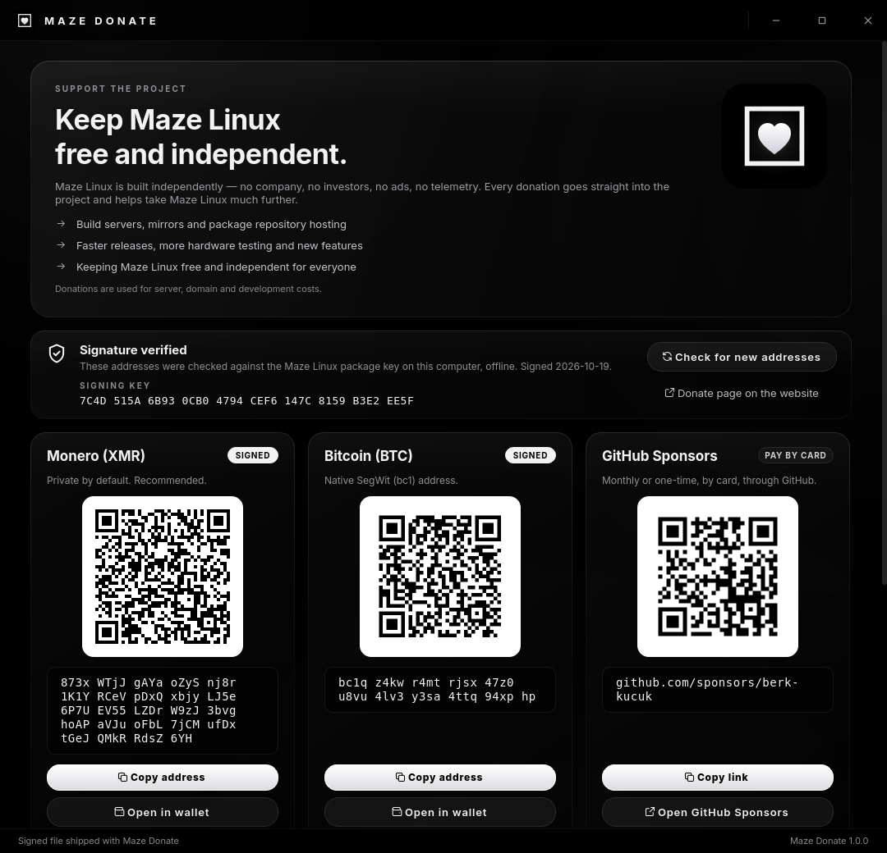
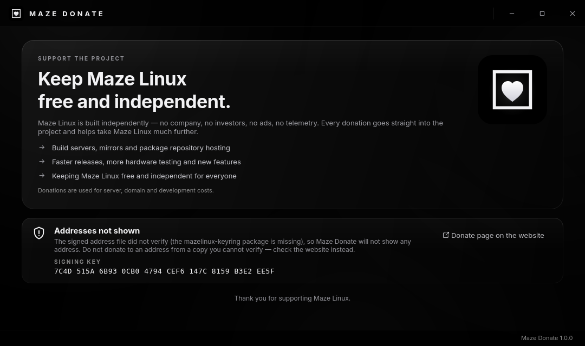
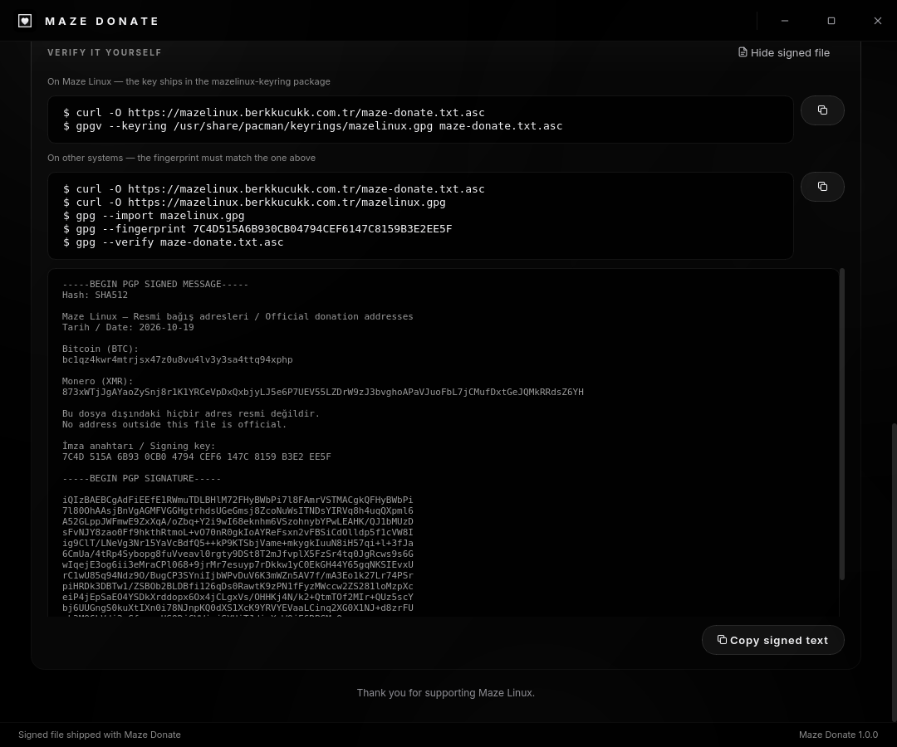
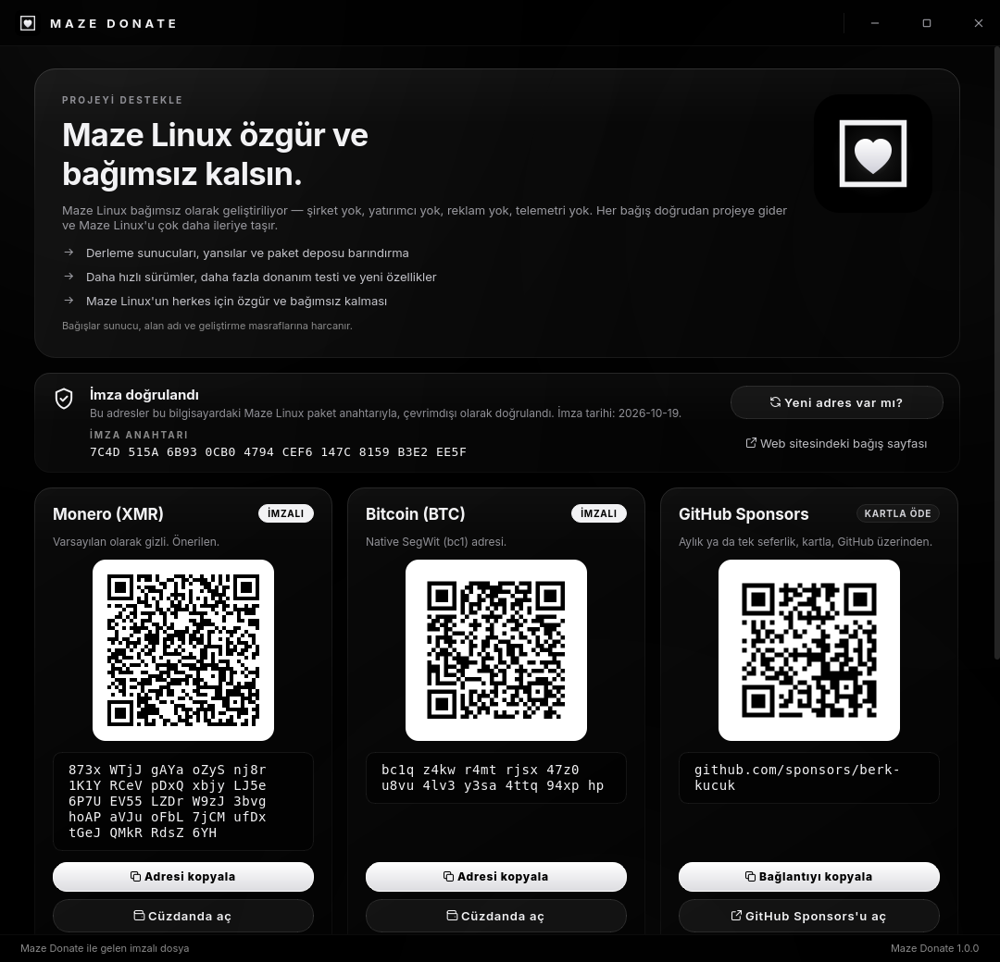

<div align="center">


# MAZE DONATE

**Support Maze Linux with addresses you can trust**

*Official donation addresses · Verified offline against the package signing key · No root, no tracking*

---

[](https://python.org)
[](https://pypi.org/project/PyQt6/)
[](https://archlinux.org)
[](https://mazelinux.berkkucukk.com.tr/#donate)
[](LICENSE)

</div>

---



## What is Maze Donate?

Maze Linux is built independently: no company, no investors, no ads and no
telemetry. Maze Donate keeps the official ways to support the project in the
application menu, so you never have to search for an address or trust one
pasted somewhere online.

| Method | Address / link |
|---|---|
| **Monero (XMR)** | `873xWTjJgAYaoZySnj8r1K1YRCeVpDxQxbjyLJ5e6P7UEV55LZDrW9zJ3bvghoAPaVJuoFbL7jCMufDxtGeJQMkRRdsZ6YH` |
| **Bitcoin (BTC)** | `bc1qz4kwr4mtrjsx47z0u8vu4lv3y3sa4ttq94xphp` |
| **GitHub Sponsors** | <https://github.com/sponsors/berk-kucuk> (card payment, monthly or one-time) |

Donations pay for build servers, mirrors, package repository hosting, the
domain and development.

## Features

- **QR code for every method.** Scan it with a phone wallet. The codes are dark
  on a white tile with a full quiet zone, so every scanner reads them.
- **Copy button.** Copies the exact signed value. The address is shown in
  groups of four so you can compare it with what your wallet pasted.
- **Open in wallet.** Opens `monero:` and `bitcoin:` links in your wallet app,
  and the Sponsors page in your browser.
- **Offline signature check on every launch.** See below.
- **Check for new addresses.** If the addresses ever change, one click fetches
  the newly signed list.
- **Verify it yourself.** The window lists the exact `gpgv` / `gpg` commands and
  shows the full signed file.
- **English by default.** Turkish and German are available with `--lang=tr` and
  `--lang=de`.
- **Same look as the rest of Maze.** Black and white glass, a frameless window
  with its own title bar, and a single instance per user.

## Why you can trust what it shows

The crypto addresses are **not written in the code**. They come from
[`data/maze-donate.txt.asc`](data/maze-donate.txt.asc), the same clearsigned
file the website publishes. Maze Donate shows an address only after `gpgv` has
verified that file against the Maze Linux package key from
`mazelinux-keyring`:

```
7C4D 515A 6B93 0CB0 4794 CEF6 147C 8159 B3E2 EE5F
```

- **The key is pinned.** A good signature from any other key is refused.
- **What you see is what was signed.** The cards are built from the text that
  gpgv returns after a good signature, not from the raw file. An edited file
  cannot put a different address on screen.
- **Nothing is shown if verification fails.** There is no "show anyway". The
  page explains what went wrong and points to the website:

  

- **No unsigned extras.** A file with text before or after the signed block is
  refused, so nothing can sit next to the signature and look official.
- **Strict address formats.** After the signature check, each address must also
  be a well-formed bech32 Bitcoin address or a 95-character Monero address.
- **Clipboard warning.** Clipboard-swapping malware replaces the middle of an
  address and hopes you only glance at it. The window reminds you to compare
  the first and last characters after you paste.

### When the addresses change

**Check for new addresses** downloads `maze-donate.txt.asc` from
`mazelinux.berkkucukk.com.tr`, but only when you press it. Nothing about you is
sent. The new file must pass the same checks. It is saved to
`~/.local/share/maze-donate/` only if its signature is **newer** than the one
you already have. An older signature is refused, so an attacker cannot replay a
signed list of retired addresses. If the saved copy ever stops verifying, it is
ignored and the copy shipped in the package is used.

### GitHub Sponsors

The current signed file predates GitHub Sponsors. Until it lists Sponsors, the
link is built into the app and its card shows *Pay by card* instead of
*Signed*. Once a signed file contains

```
GitHub Sponsors:
github.com/sponsors/berk-kucuk
```

the app takes the link from the signed file and the card shows *Signed*.

## Verify it yourself



On Maze Linux, where the key ships in `mazelinux-keyring`:

```bash
curl -O https://mazelinux.berkkucukk.com.tr/maze-donate.txt.asc
gpgv --keyring /usr/share/pacman/keyrings/mazelinux.gpg maze-donate.txt.asc
```

On other systems, first check that the fingerprint matches the one above:

```bash
curl -O https://mazelinux.berkkucukk.com.tr/maze-donate.txt.asc
curl -O https://mazelinux.berkkucukk.com.tr/mazelinux.gpg
gpg --import mazelinux.gpg
gpg --fingerprint 7C4D515A6B930CB04794CEF6147C8159B3E2EE5F
gpg --verify maze-donate.txt.asc
```

## Installation

### From the Maze repository

Maze Donate is part of the default Maze Linux desktop (through `maze-meta`).
To install it by hand:

```bash
sudo pacman -S maze-donate
```

### Build the package yourself

```bash
./build-pkg.sh                 # runs the tests, then makepkg → dist-pkg/
sudo pacman -U dist-pkg/maze-donate-*.pkg.tar.zst
```

### Run from source

```bash
/opt/maze/venv/bin/python3 main.py            # English (default)
/opt/maze/venv/bin/python3 main.py --lang=tr  # Türkçe
/opt/maze/venv/bin/python3 main.py --lang=de  # Deutsch
```

<details>
<summary>Türkçe görünüm</summary>



</details>

## Requirements

| Package | Why |
|---|---|
| `maze-python` | Shared Python runtime with PyQt6 (`/opt/maze/venv`) |
| `python-qrcode` | Builds the QR matrix; drawing is done with QPainter |
| `gnupg` | Provides `gpgv` |
| `mazelinux-keyring` | Provides `/usr/share/pacman/keyrings/mazelinux.gpg`, the signing key |

## Files

```
maze-donate/
├── main.py                      entry point
├── mazedonate/
│   ├── core/addresses.py        gpgv verification, parsing, update/rollback rules (no Qt)
│   └── gui/                     window, QR codes, glass theme, strings (en/tr/de)
├── data/maze-donate.txt.asc     the signed address list shipped with the package
├── tests/test_addresses.py      real gpgv checks: tampering, wrong key, rollback, …
├── packaging/PKGBUILD
└── build-pkg.sh
```

Installed paths: `/opt/maze-donate/`, `/usr/bin/maze-donate`,
`/usr/share/applications/maze-donate.desktop`, and icons under
`/usr/share/icons/hicolor/`.

## Updating the addresses (maintainers)

1. Edit the list, then sign it with the package key:
   `gpg --local-user 7C4D515A6B930CB04794CEF6147C8159B3E2EE5F --clearsign maze-donate.txt`
2. Publish `maze-donate.txt.asc` on the website. Installed copies pick it up
   with **Check for new addresses**.
3. Copy it to `data/maze-donate.txt.asc` and release a new package, so that new
   installs ship it.

## Testing

```bash
QT_QPA_PLATFORM=offscreen /opt/maze/venv/bin/python3 -m unittest discover -s tests -v
```

The tests run the real `gpgv` against the installed keyring and the shipped
signed file. They check that a changed address, a different key, text outside
the signature, an oversized file and an older signature are all refused, and
that a damaged user copy falls back to the shipped one. No network is used.

## License

GPL-3.0-or-later © Berk Küçük. See [LICENSE](LICENSE).
